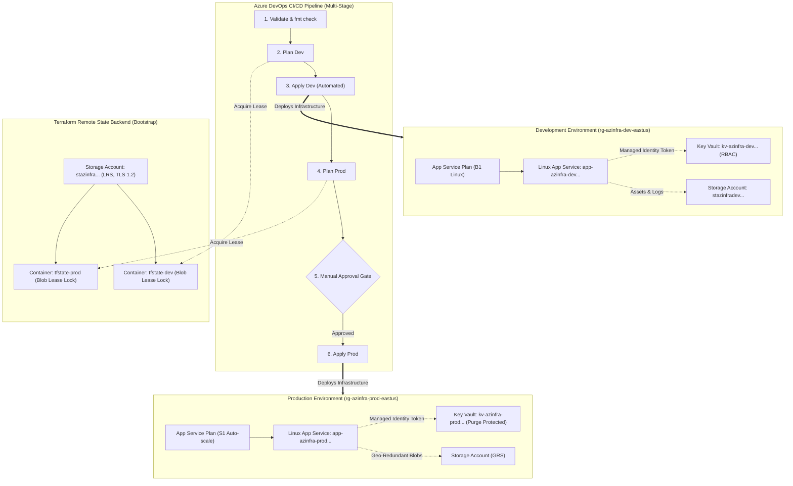
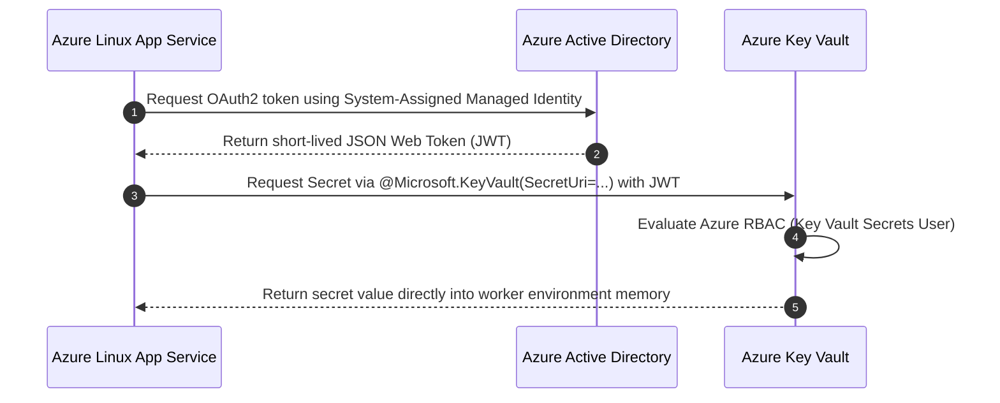

# Azure Infrastructure Provisioning & Deployment Automation Using Terraform

[](https://github.com/Bharathsirikonda/azure-infrastructure-automation/actions/workflows/terraform-ci.yml)
[](https://www.terraform.io)
[](https://registry.terraform.io/providers/hashicorp/azurerm/latest)
[](https://azure.microsoft.com/en-us/products/devops/)
[](LICENSE)

An enterprise-grade, portfolio-ready Infrastructure as Code (IaC) project demonstrating end-to-end cloud infrastructure automation on **Microsoft Azure** using **Terraform** and **Azure DevOps multi-stage pipelines**.

---

## 1. Project Overview & Problem Statement

### The Problem:
Modern engineering organizations often face severe friction, security vulnerabilities, and deployment downtime due to:
- **Manual ClickOps:** Inconsistent and error-prone resource configuration via the Azure Portal.
- **Credential Leakage:** Plaintext secrets, connection strings, and API keys embedded in Git commits, Docker images, or pipeline scripts.
- **State File Collisions:** Uncoordinated team members corrupting local or unsecured Terraform state files without concurrency locks.
- **Drift & Lack of Governance:** Untracked changes made directly in cloud consoles leading to staging/production configuration discrepancies.

### The Solution:
This project delivers a production-grade, zero-plaintext automation framework featuring:
1. **Modular Reusable Terraform Architecture:** Encapsulates Resource Groups, Storage Accounts, Key Vaults, and Linux App Services into standardized, DRY modules.
2. **Distributed Remote State & State Locking:** Employs an isolated Azure Blob Storage backend with native Blob Lease locking and versioning.
3. **Zero-Secret Key Vault & Managed Identity Integration:** Uses Azure Active Directory System-Assigned Managed Identity and RBAC (`Key Vault Secrets User`) to inject secrets into App Service runtime memory via `@Microsoft.KeyVault(...)` references.
4. **Multi-Stage Azure DevOps CI/CD Pipeline:** Enforces code formatting checks, static syntax validation, planning with published artifacts, and gated production deployments requiring manual approval.

---

## 2. High-Level Architecture Diagram



---

## 3. Technology Stack

| Layer | Technology | Version | Purpose |
|---|---|---|---|
| **Cloud Provider** | Microsoft Azure | Global Cloud | Compute, storage, identity, and cryptographic secret hosting |
| **Infrastructure as Code** | HashiCorp Terraform | `>= 1.5.0, < 2.0.0` (Tested v1.9.8) | Declarative cloud resource provisioning |
| **Azure Provider** | `hashicorp/azurerm` | `>= 3.90.0, < 4.0.0` (Tested v3.117.1) | Official Azure Resource Manager Terraform provider |
| **CI/CD Platform** | Azure DevOps | YAML Pipelines | Automated validation, planning, approval gates, and deployment |
| **Continuous Integration** | GitHub Actions | Workflows v4 | Repository-level syntax linting and PR validation |
| **Compute Engine** | Azure App Service | Linux (Node 20 LTS) | Application microservice hosting with HTTPS enforcement |
| **Security & Secrets** | Azure Key Vault | Standard Tier (RBAC) | Hardware-backed secret store with zero-plaintext injection |
| **State Storage** | Azure Blob Storage | Standard LRS / TLS 1.2 | Distributed state persistence and concurrency lease locking |
| **Scripting & Tooling** | PowerShell 7 / Bash / Azure CLI | Latest | Local automation, credential bootstrapping, and cost breakdown |

---

## 4. Repository Structure

```
azure-infrastructure-automation/
├── .github/
│   └── workflows/
│       └── terraform-ci.yml             # GitHub Actions automated lint & validation workflow
├── azure-pipelines/
│   ├── azure-pipelines.yml              # Multi-stage Azure DevOps CI/CD pipeline
│   └── templates/
│       ├── terraform-install.yml        # Reusable installer task
│       ├── terraform-validate.yml       # Formatting & syntax validation
│       ├── terraform-plan.yml           # Execution plan generator & artifact publisher
│       └── terraform-apply.yml          # Controlled apply step with output retrieval
├── bootstrap/                           # Phase 1: Storage Account bootstrapper for remote state
│   ├── main.tf
│   ├── variables.tf
│   ├── outputs.tf
│   ├── versions.tf
│   └── terraform.tfvars.example
├── modules/                             # Reusable Terraform Modules
│   ├── resource-group/
│   │   ├── main.tf
│   │   ├── variables.tf
│   │   └── outputs.tf
│   ├── storage-account/
│   │   ├── main.tf
│   │   ├── variables.tf
│   │   └── outputs.tf
│   ├── key-vault/
│   │   ├── main.tf
│   │   ├── variables.tf
│   │   └── outputs.tf
│   └── app-service/
│       ├── main.tf
│       ├── variables.tf
│       └── outputs.tf
├── environments/                        # Multi-Environment Infrastructure
│   ├── dev/
│   │   ├── main.tf                      # Dev sizing (B1 App Service, 7-day retention)
│   │   ├── variables.tf
│   │   ├── outputs.tf
│   │   ├── providers.tf
│   │   ├── versions.tf
│   │   ├── backend.tf
│   │   ├── dev.tfvars
│   │   └── terraform.tfvars.example
│   └── prod/
│       ├── main.tf                      # Prod sizing (S1 Auto-scale, GRS Storage, 90-day purge protection)
│       ├── variables.tf
│       ├── outputs.tf
│       ├── providers.tf
│       ├── versions.tf
│       ├── backend.tf
│       ├── prod.tfvars
│       └── terraform.tfvars.example
├── scripts/
│   ├── local-validate.ps1               # Automated local validation test suite
│   ├── setup-bootstrap.ps1              # Remote state bootstrap automation
│   ├── azure-auth-setup.ps1             # Azure Service Principal & RBAC generator
│   └── generate-cost-estimate.ps1       # Cost breakdown & Infracost estimator
├── docs/
│   ├── ARCHITECTURE.md                  # Detailed component architecture & diagrams
│   ├── REMOTE_STATE_MANAGEMENT.md       # Remote state locking, leases, and disaster recovery
│   ├── KEY_VAULT_INTEGRATION.md         # Managed Identity & zero-plaintext secret resolution
│   ├── PIPELINE_ARCHITECTURE.md         # Azure DevOps pipeline stages & approval gate setup
│   ├── COST_AND_BUDGET_ANALYSIS.md      # Financial breakdown & FinOps optimization strategies
│   └── TROUBLESHOOTING.md               # Common Terraform errors and remediation guide
├── .gitignore
├── LICENSE                              # MIT License
├── main.tf                              # Root module entry point
├── variables.tf
├── outputs.tf
├── providers.tf
├── versions.tf
└── terraform.tfvars.example
```

---

## 5. Terraform Remote State & State Locking

Remote state is essential to prevent multiple engineers or concurrent pipeline runners from corrupting infrastructure state.

### How It Works:
1. **Bootstrap Isolation:** The storage account hosting the state is created via [`bootstrap/`](file:///D:/downloads/azure-infrastructure-automation/bootstrap) with blob versioning and soft-delete protection enabled.
2. **Blob Leases:** When Terraform runs `plan` or `apply`, it requests an exclusive **Azure Blob Lease**. If another process holds the lease, Terraform halts immediately with `Error acquiring state lock`.
3. **Multi-Environment Segregation:** Dev and Prod maintain dedicated state containers (`tfstate-dev` and `tfstate-prod`), ensuring changes in development can never compromise production state.

For complete mechanics and recovery instructions, see [`docs/REMOTE_STATE_MANAGEMENT.md`](file:///D:/downloads/azure-infrastructure-automation/docs/REMOTE_STATE_MANAGEMENT.md).

---

## 6. Key Vault & Managed Identity Integration

This architecture implements a strict **Zero-Plaintext Secret** pattern:



- **App Service:** Configured with `identity { type = "SystemAssigned" }`.
- **Key Vault:** Configured with `enable_rbac_authorization = true`.
- **RBAC Role Assignment:** `Key Vault Secrets User` granted explicitly to the App Service Managed Identity principal ID.
- **Resolution:** Secrets are referenced in `app_settings` via:
  ```hcl
  "DATABASE_URL" = "@Microsoft.KeyVault(VaultName=${module.key_vault.name};SecretName=DatabaseConnectionString)"
  ```

For implementation details, see [`docs/KEY_VAULT_INTEGRATION.md`](file:///D:/downloads/azure-infrastructure-automation/docs/KEY_VAULT_INTEGRATION.md).

---

## 7. Azure DevOps CI/CD Pipeline

The pipeline is defined declaratively in [`azure-pipelines/azure-pipelines.yml`](file:///D:/downloads/azure-infrastructure-automation/azure-pipelines/azure-pipelines.yml) with modular sub-templates:

| Stage | Name | Purpose | Conditions |
|---|---|---|---|
| **1** | `Validate` | Checks `terraform fmt -check` and runs `terraform validate` across all environments | PRs & Commits |
| **2** | `Plan_Dev` | Connects to Azure via Service Connection, runs `terraform plan`, publishes artifact | Succeeded Stage 1 |
| **3** | `Apply_Dev` | Deploys planned changes to Development environment | Succeeded Stage 2 on `main` |
| **4** | `Plan_Prod` | Generates Production plan with S1 sizing and purge protection | Succeeded Stage 3 on `main` |
| **5** | `Apply_Prod` | Deploys to Production environment **after explicit manual approval** | Manual Gate in Azure DevOps |

For setup steps and Service Connection configuration, see [`docs/PIPELINE_ARCHITECTURE.md`](file:///D:/downloads/azure-infrastructure-automation/docs/PIPELINE_ARCHITECTURE.md).

---

## 8. Local Validation & Testing Instructions

You can validate the entire codebase locally without connecting to live Azure credentials:

### 1. Run the Automated Validation Suite:
```powershell
.\scripts\local-validate.ps1
```

### 2. Manual Commands:
```bash
# Check code formatting
terraform fmt -check -recursive

# Validate Development
cd environments/dev
terraform init -backend=false
terraform validate

# Validate Production
cd ../prod
terraform init -backend=false
terraform validate
```

---

## 9. Deployment Instructions (When Ready to Deploy to Azure)

> [!IMPORTANT]
> **Cost & Safety Guardrail:** Do not apply infrastructure to a live Azure subscription without verifying costs and permissions.

### Step 1: Authenticate with Azure CLI
```bash
az login
az account set --subscription "<YOUR_SUBSCRIPTION_ID>"
```

### Step 2: Bootstrap Remote State Storage
```powershell
.\scripts\setup-bootstrap.ps1 -SubscriptionId "<YOUR_SUBSCRIPTION_ID>" -Location "eastus"
```

### Step 3: Deploy Development Infrastructure
```bash
cd environments/dev
terraform init
terraform plan -var-file="dev.tfvars" -out="dev.tfplan"
terraform apply "dev.tfplan"
```

### Step 4: Destroy / Teardown Resources
```bash
terraform destroy -var-file="dev.tfvars"
```

---

## 10. Cost & Budget Breakdown

| Environment | Primary Driver | Monthly Estimate | Annual Estimate |
|---|---|---|---|
| **Development** | App Service B1, LRS Storage, Key Vault (<10k ops) | **~$12.71 / mo** | **~$152.52 / yr** |
| **Production** | App Service S1 (Auto-scale), GRS Storage, Key Vault (90-day retention) | **~$75.37 / mo** | **~$904.44 / yr** |

For optimization strategies (Azure Budgets, Reserved Instances, Free tier dev toggles), see [`docs/COST_AND_BUDGET_ANALYSIS.md`](file:///D:/downloads/azure-infrastructure-automation/docs/COST_AND_BUDGET_ANALYSIS.md).

---

## 11. Security & Compliance Controls

- **Zero-Plaintext Credentials:** No secrets committed to source code or logged in CI/CD.
- **HTTPS & TLS Enforcement:** `https_only = true` and `min_tls_version = "1.2"` enforced on all App Services and Storage Accounts.
- **RBAC Governance:** Built-in Azure RBAC roles (`Key Vault Secrets User`, `Contributor`) preferred over broad subscription-level Owner rights.
- **Soft Delete & Purge Protection:** 7-day retention on Dev, 90-day retention with Purge Protection enabled on Production Key Vaults.
- **Container Immutability:** Storage containers for remote state are private and support blob versioning with 30-day retention policies.

---

## 12. License

This project is licensed under the terms of the [MIT License](LICENSE).
