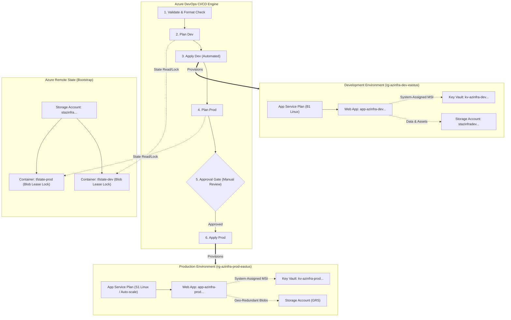
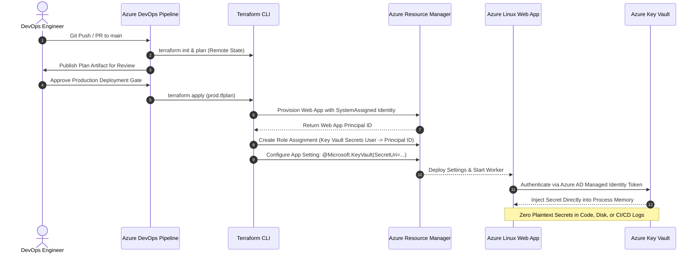

# Architecture Overview

This project implements an enterprise Infrastructure as Code (IaC) foundation on Microsoft Azure using Terraform and automated Azure DevOps CI/CD pipelines.

---

## 1. High-Level System Architecture



---

## 2. Component Design & Responsibility

| Component | Technology | Responsibility | Sizing / Tier |
|---|---|---|---|
| **Remote State Backend** | Azure Blob Storage | Shared state storage, blob lease concurrency locking, state versioning | Standard LRS, TLS 1.2, Blob Versioning |
| **Identity & Access** | Azure Active Directory & RBAC | System-assigned managed identities, least-privilege role assignment | Built-in roles (`Key Vault Secrets User`, `Contributor`) |
| **Secret Management** | Azure Key Vault | Hardware-backed cryptographic store for database strings & API keys | Standard Tier, RBAC authorization, Soft-Delete |
| **Compute / Web Layer** | Azure Linux App Service | Hosts containerized or Node.js microservices with HTTPS enforcement | Dev: B1 (Basic) / Prod: S1 (Standard Auto-scale) |
| **Object Storage** | Azure Storage Account | Application asset uploads, diagnostics, and container storage | Dev: Standard LRS / Prod: Standard GRS |
| **Orchestration Pipeline** | Azure DevOps YAML | Multi-stage pipeline enforcing format, validation, planning, approval & apply | Hosted Ubuntu runners, Service Connections |

---

## 3. Secret Retrieval Sequence (Managed Identity)



---

## 4. Modular Decomposition

```
modules/
├── resource-group/     # Encapsulates Azure Resource Group lifecycle and unified tagging
├── storage-account/    # Configures HTTPS-only, TLS 1.2, versioned blob containers
├── key-vault/          # Manages Key Vault, soft-delete, RBAC authorizations and secrets
└── app-service/        # Manages Linux App Service Plan, Web App, HTTPS enforcement, and System-Assigned MSI
```

Each module contains:
- `main.tf`: Declarative resource declarations.
- `variables.tf`: Explicit input validation and parameterization.
- `outputs.tf`: Reusable references for module consumers.
