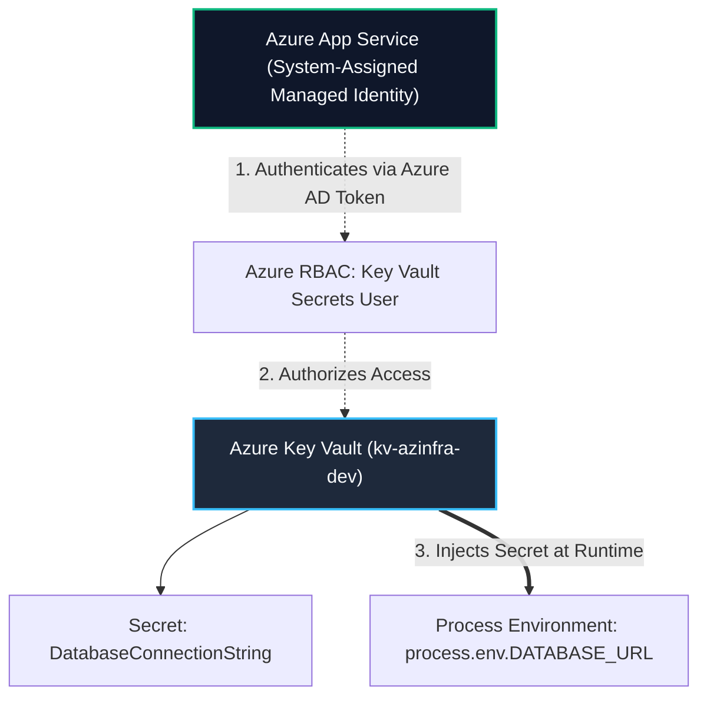

# Azure Key Vault & Managed Identity Integration

This document outlines the zero-plaintext secret management architecture used to store and inject application configuration into Azure App Services.

---

## 1. Zero-Plaintext Security Architecture

A primary anti-pattern in cloud infrastructure is storing database credentials, tokens, or private keys inside:
- Terraform `.tf` or `.tfvars` files committed to Git.
- Azure DevOps variable groups as plaintext strings.
- Pipeline execution logs.

### The Solution:
1. **Azure Key Vault** acts as the single source of truth for cryptographic secrets.
2. **System-Assigned Managed Identity (MSI)** is provisioned automatically for the Azure App Service.
3. **Azure RBAC (`Key Vault Secrets User`)** grants the App Service's principal read-only access to Key Vault secrets.
4. **App Service Key Vault References** (`@Microsoft.KeyVault(...)`) instruct Azure's host platform to fetch the secret on worker startup and inject it directly into application memory as environment variables.



---

## 2. Terraform Implementation

### Step 1: App Service with Managed Identity
In [`modules/app-service/main.tf`](file:///D:/downloads/azure-infrastructure-automation/modules/app-service/main.tf):
```hcl
resource "azurerm_linux_web_app" "this" {
  name                = var.name
  resource_group_name = var.resource_group_name
  location            = var.location
  service_plan_id     = azurerm_service_plan.this.id

  # Enables Azure AD System-Assigned Managed Identity
  identity {
    type = "SystemAssigned"
  }
}
```

### Step 2: Key Vault RBAC Assignment
In [`modules/key-vault/main.tf`](file:///D:/downloads/azure-infrastructure-automation/modules/key-vault/main.tf):
```hcl
# Grant read-only access to the App Service Managed Identity
resource "azurerm_role_assignment" "secrets_user" {
  for_each             = toset(var.reader_principal_ids)
  scope                = azurerm_key_vault.this.id
  role_definition_name = "Key Vault Secrets User"
  principal_id         = each.value
}
```

### Step 3: Native Key Vault Reference in App Settings
In [`environments/dev/main.tf`](file:///D:/downloads/azure-infrastructure-automation/environments/dev/main.tf):
```hcl
module "app_service" {
  source = "../../modules/app-service"
  # ...
  app_settings = {
    "NODE_ENV"     = "development"
    "DATABASE_URL" = "@Microsoft.KeyVault(VaultName=${module.key_vault.name};SecretName=DatabaseConnectionString)"
    "API_KEY"      = "@Microsoft.KeyVault(VaultName=${module.key_vault.name};SecretName=ApiKey)"
  }
}
```

---

## 3. Application Consumption (Node.js Example)

Inside application code, developers simply read standard environment variables. The platform automatically resolves the Key Vault reference transparently:

```javascript
// server.js
const dbUrl = process.env.DATABASE_URL;
const apiKey = process.env.API_KEY;

console.log(`Connected to database securely without embedding credentials in source code.`);
```

---

## 4. Security Verification Checklist

- [x] No plaintext passwords or connection strings committed to Git.
- [x] Key Vault soft-delete enabled (7 days in Dev, 90 days in Prod).
- [x] Key Vault Purge Protection enabled in Production.
- [x] Role-Based Access Control (RBAC) preferred over legacy access policies.
- [x] App Service enforces HTTPS traffic only (`https_only = true`).
- [x] Minimum TLS version set to 1.2 across all storage and web services.
