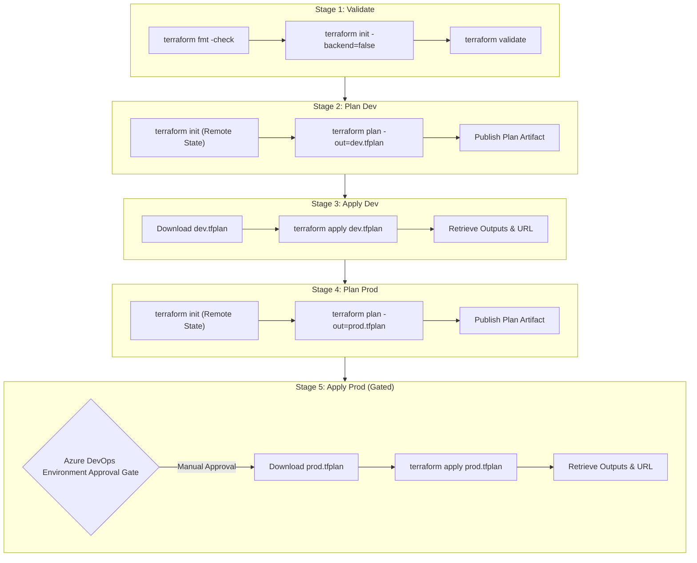

# Azure DevOps CI/CD Pipeline Architecture

This document describes the multi-stage Azure DevOps YAML pipeline designed to automate testing, planning, and deploying Azure infrastructure using Terraform.

---

## 1. Pipeline Stages & Execution Flow

---

## 2. Stage Breakdown

### Stage 1: Code Quality & Validation (`Validate`)
- **Trigger:** Runs on every pull request and push to `main`.
- **Tasks:**
  - Installs specified Terraform version (`1.9.8`).
  - Checks recursive formatting (`terraform fmt -check -recursive`).
  - Performs local syntax and schema validation across `bootstrap/`, `environments/dev/`, and `environments/prod/` without requiring Azure network access.

### Stage 2: Development Infrastructure Plan (`Plan_Dev`)
- **Trigger:** Runs after successful validation.
- **Tasks:**
  - Connects to Azure using the configured Service Connection.
  - Generates binary execution plan `dev.tfplan` using `dev.tfvars`.
  - Publishes `dev.tfplan` and human-readable `dev-plan.txt` as pipeline artifacts.

### Stage 3: Development Infrastructure Apply (`Apply_Dev`)
- **Trigger:** Automatic upon `Plan_Dev` completion on the `main` branch.
- **Tasks:**
  - Deploys the exact planned changes.
  - Outputs the newly provisioned App Service URL and Resource Group.

### Stage 4: Production Infrastructure Plan (`Plan_Prod`)
- **Trigger:** Runs following successful Dev deployment.
- **Tasks:**
  - Generates production plan `prod.tfplan` using production sizing (`S1`, `GRS` storage, purge protection).
  - Publishes `prod.tfplan` for architectural review.

### Stage 5: Production Infrastructure Apply (`Apply_Prod`)
- **Trigger:** Gated by **Azure DevOps Environment Approvals**.
- **Governance:** An authorized Cloud Architect or Lead Engineer must review the published plan and approve the deployment in the Azure DevOps portal before any changes touch production.

---

## 3. Configuring the Azure Service Connection

To connect Azure DevOps to your Azure Subscription:
1. In Azure DevOps, go to **Project Settings** > **Service connections** > **New service connection**.
2. Select **Azure Resource Manager** > **Service principal (manual)**.
3. Fill in the credentials generated via [`scripts/azure-auth-setup.ps1`](file:///D:/downloads/azure-infrastructure-automation/scripts/azure-auth-setup.ps1):
   - **Subscription ID:** Your Azure Subscription GUID
   - **Subscription Name:** e.g., `Pay-As-You-Go` or `Enterprise Sub`
   - **Service Principal Client ID (`appId`):** The Application ID
   - **Service Principal Key (`password`):** The client secret
   - **Tenant ID:** Your Azure AD Directory ID
4. Name the connection: `azure-rm-service-connection`.
5. Check **Grant access permission to all pipelines**.
