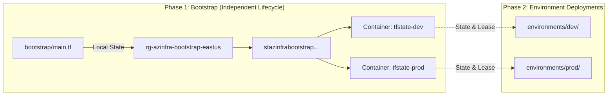

# Terraform Remote State Management on Azure

This document details the architecture, configuration, locking mechanics, and recovery procedures for managing Terraform remote state in Azure Blob Storage.

---

## 1. Why Remote State is Required

When running Terraform in a team or enterprise CI/CD setting, local state (`terraform.tfstate`) is insufficient:

1. **Team Concurrency:** Multiple engineers running `terraform apply` concurrently without coordination would overwrite each other's changes, corrupting the infrastructure state.
2. **State Locking:** Azure Blob Storage provides native distributed locking via Blob Leases, preventing simultaneous modifications.
3. **Security & Compliance:** Terraform state files often contain sensitive metadata (resource IDs, IP addresses, generated passwords). Storing state in Azure Blob Storage ensures encryption at rest (Microsoft-managed or customer-managed keys) and in-transit (HTTPS/TLS 1.2).
4. **CI/CD Automation:** Pipeline agents are ephemeral. A centralized remote backend ensures that every pipeline run interacts with the ground-truth state file.

---

## 2. Architecture & Bootstrap Process

To avoid a "chicken-and-egg" dilemma (using Terraform to manage the storage account that stores Terraform's own state), the architecture is partitioned into two phases:



### Safety Rules:
- The bootstrap infrastructure has its own isolated lifecycle.
- State deletion retention policy (30 days) and blob versioning are enabled on the bootstrap storage account, allowing recovery of previous state versions if accidental corruption occurs.

---

## 3. How State Locking Works in Azure Blob Storage

When Terraform initializes with the `azurerm` backend:
1. Prior to performing `terraform plan` or `terraform apply`, Terraform requests an exclusive **Blob Lease** from Azure Blob Storage on the state blob (e.g., `dev.terraform.tfstate`).
2. If another execution (developer or pipeline) holds the lease, Azure returns:
   ```
   Error: Error acquiring the state lock
   Lock Info:
     ID:        <uuid>
     Path:      .../dev.terraform.tfstate
     Who:       azure-devops-agent@pipeline-runner
   ```
3. Terraform blocks or fails fast, preventing concurrent state file updates.
4. Once the operation finishes, Terraform releases the blob lease.

---

## 4. Backend Configuration Example

In `environments/dev/backend.tf`:
```hcl
terraform {
  backend "azurerm" {
    resource_group_name  = "rg-azinfra-bootstrap-eastus"
    storage_account_name = "stazinfrabootstrapstate"
    container_name       = "tfstate-dev"
    key                  = "dev.terraform.tfstate"
  }
}
```

### Dynamic Initialization in CI/CD:
In automated pipelines, credentials and backend parameters are supplied dynamically:
```bash
terraform init \
  -backend-config="resource_group_name=rg-azinfra-bootstrap-eastus" \
  -backend-config="storage_account_name=stazinfrabootstrapstate" \
  -backend-config="container_name=tfstate-dev" \
  -backend-config="key=dev.terraform.tfstate"
```

---

## 5. Troubleshooting Remote State Issues

### Issue 1: State Lock Contention (`Error acquiring the state lock`)
- **Cause:** A previous pipeline execution was terminated abnormally without releasing the Blob Lease.
- **Remediation:**
  1. Verify no active pipeline is modifying the environment.
  2. Force unlock using Terraform:
     ```bash
     terraform force-unlock <LOCK_ID>
     ```
  3. Or break the lease via Azure CLI:
     ```bash
     az storage blob lease break \
       --account-name "stazinfrabootstrapstate" \
       --container-name "tfstate-dev" \
       --blob-name "dev.terraform.tfstate"
     ```

### Issue 2: Storage Account Authentication Denied
- **Cause:** Pipeline service principal lacks access to storage account keys or blob data.
- **Remediation:** Assign `Storage Blob Data Contributor` role or supply `ARM_ACCESS_KEY` environment variable.
